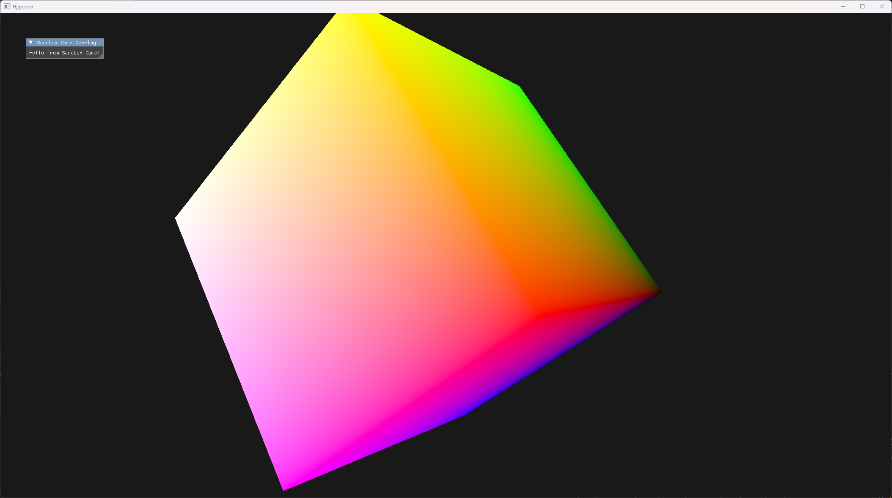

# Hyperion

A C++20 game engine built on Vulkan, with a small sandbox application used to develop and demonstrate the engine systems. Hyperion is a work in progress and is primarily built to explore engine architecture and rendering from the ground up.

## Features

- Vulkan 1.3 renderer with dynamic rendering, swap-chain recreation, timeline semaphores, and two frames in flight
- EnTT-backed ECS and entity/world APIs
- Mesh cache that uploads CPU-provided meshes to GPU vertex and index buffers (VMA)
- Transform and primary-camera components
- GLFW windowing, keyboard and mouse events, and resize handling
- Dear ImGui docking overlay integration
- CMake build presets and a vcpkg manifest for dependencies

## Project Structure

- `Hyperion/` — engine library: application lifecycle, ECS, Vulkan rendering, resources, events, and UI
- `Sandbox/` — example game that creates a colored cube and a primary camera
- `vcpkg.json` — manifest-mode dependency declarations
- `CMakePresets.json` — Visual Studio/CMake presets for Windows and other host systems

## Architecture

A `Game` implementation supplies application metadata and lifecycle callbacks to `Application`. The application creates the window, Vulkan device, renderer, mesh cache, and ImGui overlay, then runs the frame loop.

The ECS stores entities and components in an EnTT registry. Mesh and camera components are supplied by the sandbox game, and the renderer queries the primary camera and mesh entities during rendering. The mesh cache stores CPU-provided meshes and uploads their vertex and index data to GPU buffers managed through Vulkan Memory Allocator.

The Vulkan renderer owns the swap chain, frame resources, synchronization, dynamic rendering setup, and mesh pipeline. Window and input events are routed from GLFW through the engine event system to the active game.

## Sandbox Controls

Use the following keys to move or rotate the primary camera:

- `W` / `S` — rotate around X
- `A` / `D` — rotate around Y
- `Q` / `E` — rotate around Z
- Arrow keys — translate the camera

## Building on Windows

### Prerequisites

- Visual Studio with C++ CMake tools
- A 64-bit Windows toolchain with `cl.exe`
- [LunarG Vulkan SDK](https://vulkan.lunarg.com/), with `VULKAN_SDK` set
- [vcpkg](https://vcpkg.io/), with `VCPKG_ROOT` set

### Visual Studio

1. Clone the repository:

   ```powershell
   git clone https://github.com/JohnsonHStephen/Hyperion.git
   cd Hyperion
   ```

2. Open the repository folder in Visual Studio.

3. Select the `x64-debug` CMake preset, configure, and build the `Sandbox` target.

4. Run `Sandbox`.

The `x64-release`, `x86-debug`, and `x86-release` presets are also available.

Builds compile `shader.vert` and `shader.frag` through `glslc` before building the engine.

## Dependencies

- EnTT
- GLFW
- GLM
- Dear ImGui with docking support
- stduuid
- Vulkan Headers, Loader, and Validation Layers
- Vulkan Memory Allocator
- Volk

## Roadmap

- Asset manager and file-based mesh loading
- Textured meshes and texture resources
- Dedicated UI rendering pipeline
- Wireframe and debug rendering
- Additional sample applications and rendering features

## Images


## References

- [Vulkan Tutorial](https://vulkan-tutorial.com/)
- [Game Engine Architecture](https://www.gameenginebook.com/) by Jason Gregory
- [How I learned Vulkan and wrote a small game engine with it](https://edw.is/learning-vulkan/)